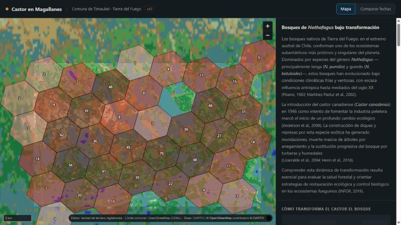
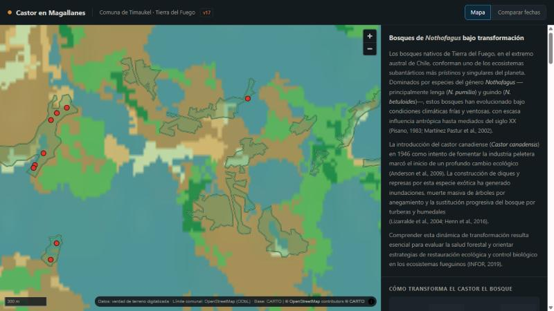

<div align="center">

# 🦫 Castor en Magallanes

**Visor web del impacto de *Castor canadensis* en Tierra del Fuego**

Sitio estático que publica 806 diques y 241 polígonos de impacto digitalizados
sobre la comuna de Timaukel, con la cobertura de suelo de fondo y una serie NDVI comparable.

<br>


<br>



</div>

---

## Qué es

Una web de una sola página, sin backend, sin servidor de tiles y sin build. Todo lo que
muestra está precalculado: GeoJSON, PNG y un `metricas.json` que el navegador lee directo.
Se publica abriendo la carpeta con cualquier servidor estático.

El ámbito es deliberadamente estrecho: **la comuna de Timaukel**, en Tierra del Fuego. El área
con datos digitalizados son 130,67 km², un **0,94 %** de los 13.945 km² de la comuna. El sitio
lo dice explícitamente, para que nadie lea el recuadro vacío como ausencia de castores.

---

## Qué muestra

### El mapa

Cinco capas conmutables sobre un fondo de cobertura de suelo:

| Capa | Qué es |
|:--|:--|
| **Cobertura** | MapBiomas Chile Col. 2, año 2024, en dos escalas: la comuna completa y el área de estudio a mayor resolución |
| **Impacto** | 241 polígonos, 2.039 ha, el **15,6 %** del área de estudio |
| **Diques** | 806 puntos, 6,17 por km² |
| **Timaukel** | Límite comunal (OpenStreetMap, ODbL) |
| **Sitios** | Recuadros del área de estudio y sus sectores |

**Agregación progresiva con H3.** Ochocientos puntos juntos son una mancha, así que los diques
se relevan por zoom. Cada hexágono lleva su conteo y se desvanece al acercarse al corte, para
que el polígono de impacto asome antes del cambio de nivel:

| Zoom | Qué se dibuja | Celdas | Mediana |
|:--|:--|--:|--:|
| ≤ 11,6 | Hexágonos H3 res 7 (~5,2 km²) | 37 | 14 diques |
| 11,6 – 13,2 | Hexágonos H3 res 8 (~0,74 km²) | 144 | 4 diques |
| ≥ 13,2 | Diques individuales | 806 | — |

<div align="center">

</div>

### Comparar fechas

Cuatro paneles NDVI sincronizados —**2017-11-06, 2018-11-28, 2022-03-10 y 2025-04-03**— que se
mueven juntos. Las cuatro fechas se eligieron por tener entre 97 % y 100 % de píxeles
despejados, y comparten una escala fija (0,20–0,90) para que el color signifique lo mismo en
los cuatro paneles.

### El panel lateral

Además de la introducción sobre los bosques de *Nothofagus* y las ilustraciones del
comportamiento del castor, el panel publica lo que se midió sobre estos datos:

- **Separación entre diques** — mediana de **55,7 m**. A 10 m de píxel los diques vecinos son
  inseparables: la unidad detectable es el complejo de lagunas, no el dique.
- **Trayectoria de cobertura, 1999–2024** — dentro del impacto el bosque cae de **59,2 % a
  8,8 %** hacia 2018, con dos caídas separadas (2005, y 2011–2014). En el resto del paisaje, en
  el mismo período, solo baja de 52,4 % a 38,7 %.
- **Enriquecimiento por clase, 2018** — matorral ×3,78 y estepa ×6,56 dentro del impacto. Pero
  **humedal queda depletado (×0,20)**, no enriquecido: el fondo del paisaje ya es 40 % humedal
  natural, así que aquí clasificar algo como humedal lo hace *menos* probable de ser castor.
- **Firma espectral (AUC)** — nueve índices ordenados por separabilidad. Mandan el SWIR
  (B12, 0,785) y el NBR (0,237, invertido); **MNDWI, el índice de agua, es el peor de los
  nueve**. La firma es biomasa seca y abierta, no agua.
- **Archivo Landsat** — escenas utilizables por año entre 1985 y 2024, con **diez años sin
  dato** por falta de estación receptora en el extremo austral.
- **El problema en cifras** — contexto nacional, señalado como tal porque no son mediciones de
  estos datos.

### Documentos

Tres láminas cartográficas de **CIREN · Ministerio de Agricultura** a escala 1:20.000,
descargables en PDF. Cada ficha anuncia formato y peso, porque una de ellas son 18,3 MB.

---

## Estructura

```
web/
├── index.html            # Una sola página
├── app.js                # MapLibre, capas, gráficos SVG, todo a mano
├── style.css
├── _headers              # Caché de Cloudflare Pages
├── vendor/               # MapLibre GL vendorizado: sin CDN en caliente
├── datos/
│   ├── metricas.json     # Todas las cifras del panel
│   ├── diques.geojson        · 806 puntos
│   ├── impacto.geojson       · 241 polígonos
│   ├── hex_grueso.geojson    · 37 celdas H3 res 7
│   ├── hex_fino.geojson      · 144 celdas H3 res 8
│   ├── timaukel.geojson      · límite comunal
│   ├── cobertura/            · PNG de MapBiomas, 2 escalas
│   └── ndvi/                 · 4 paneles PNG
└── documentos/           # Láminas CIREN en PDF + miniaturas
```

---

## Fuentes de datos

| Fuente | Qué aporta al sitio |
|:--|:--|
| **Sentinel-2 MSI L2A** · Copernicus | Paneles NDVI, firma espectral |
| **Landsat 5/7/8/9 Collection 2** · USGS | Disponibilidad de archivo 1985–2024 |
| **MapBiomas Chile, Colección 2** | Cobertura de fondo y trayectoria 1999–2024 |
| **OpenStreetMap** (ODbL) | Límite comunal de Timaukel |
| **CIREN · Ministerio de Agricultura** | Láminas cartográficas 1:20.000 |
| **CARTO** | Estilo base y glyphs del mapa |

La verdad de terreno —806 diques y 241 polígonos— está digitalizada sobre Tierra del Fuego.
Las superficies salen de la geometría, no del campo `Ha` del archivo original.

---

<div align="center">
<sub>

Comuna de Timaukel · Región de Magallanes y de la Antártica Chilena, Chile

</sub>
</div>
